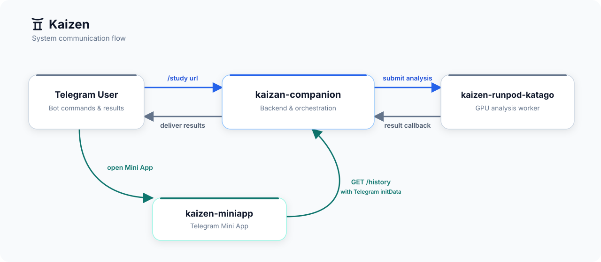

# ⛩️ Kaizen

**Go (Baduk) game analysis powered by KataGo, delivered through a Telegram bot — with a Mini App to practice your own mistakes.**

| Project | Description | Deployment |
|---|---|---|
| [**kaizen-companion**](https://github.com/eduardoSantiag0/kaizen-companion) | Backend — Telegram bot, orchestration, database | Self-hosted VM (Docker Compose + Caddy) |
| [**kaizen-miniapp**](https://github.com/eduardoSantiag0/kaizen-miniapp) | Frontend — Telegram Mini App for practicing mistakes | Vercel |
| [**kaizen-runpod-katago**](https://github.com/eduardoSantiag0/kaizen-runpod-katago) | GPU worker — runs the KataGo engine | RunPod Serverless |

---

## What the System Does

1. Send `/study <game-url>` to the Telegram bot (supports OGS and Dragon Go Server).
2. **kaizan-companion** downloads the game, saves the job, and queues the analysis.
3. **kaizen-runpod-katago** runs KataGo on a GPU, identifies the most decisive moves in each game phase (opening/middlegame/endgame), and returns the results.
4. **kaizan-companion** receives the results, generates SGF files for each phase, and delivers them through Telegram (with options to also send them via email or save them to Google Drive).
5. Through **kaizen-miniapp**, you can open analyzed games directly in Telegram and practice against KataGo's recommended moves — 101weiqi-style.

---

## How the Three Components Communicate

- **kaizan-companion ↔ kaizen-runpod-katago**: Server-to-server communication. The backend submits analysis requests via HTTP to the RunPod Serverless endpoint; the worker returns results through an HTTP callback authenticated with a shared secret (`X-Kaizen-Secret`).
- **kaizan-companion ↔ kaizen-miniapp**: The Mini App calls `GET /kaizan/api/v1/katago/history` on the backend, authenticating with the signed `initData` provided by Telegram when the Mini App is launched from within Telegram — never relying on a user ID freely supplied by the client.
- The Telegram bot uses **webhooks** in production (the backend registers a public HTTPS URL that Telegram calls whenever a new message arrives) and **long-polling** during local development (no public domain required).

---

## Infrastructure

- **kaizen-companion** runs on a dedicated VM (Caddy providing automatic HTTPS via Let's Encrypt, PostgreSQL, RabbitMQ, and a lightweight proxy for the RunPod status API) — all managed through `docker compose`.
- **kaizen-miniapp** is a static Angular SPA with no backend of its own — hosted on Vercel.
- **kaizen-runpod-katago** packages KataGo with CUDA into a Docker image published on Docker Hub, used by a RunPod Serverless endpoint (on-demand GPU, scaling to zero when idle).
